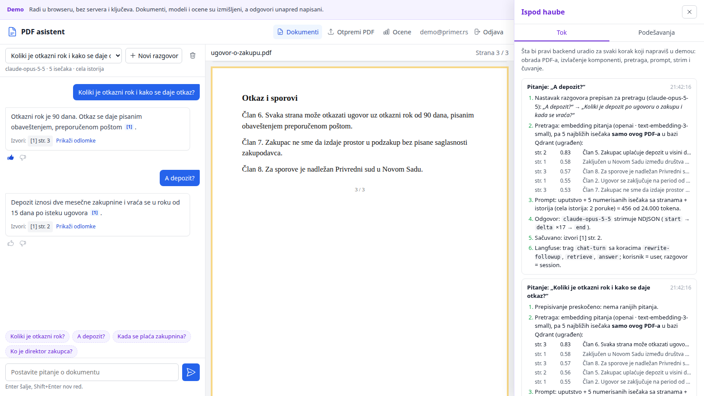
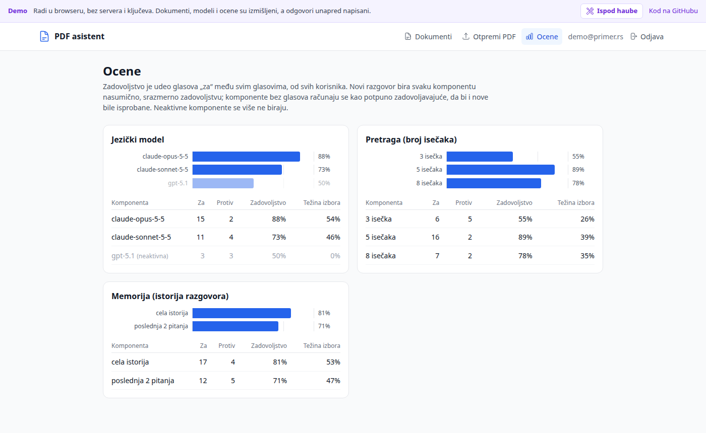

# pdf_assistant

People with one long document, such as a contract or house rules, want answers from it that they can
check against the page they come from. pdf_assistant lets them upload the PDF and ask: answers come
only from the document's passages and cite their page, and clicking a source opens that page beside
the conversation. The problem, the approach and its limits are in the
[vision](docs/product/vision.md).

> **Status: frozen as a demo since 2026-11-10; no work planned.** The app works, but no new
> features are added here. Everything that would come next (scans and OCR, folders, several
> documents, a shared knowledge base) already exists in
> [document-buddy](https://github.com/ManSe404/document-buddy), which is moving to the Mosaic
> library. Bug fixes are still welcome. The decision is
> [ADR 0002](docs/adr/0002-freeze-as-a-demo.md).

The app is also a small experiment. Every conversation is given, at random, one language model, a
number of passages to retrieve and an amount of history to send to the model. Users rate answers with
a thumb up or down, and new conversations get better-rated combinations more often. The "Scores" page
shows how each component is doing.

FastAPI, SQLAlchemy and Alembic, Svelte 5; Claude, OpenAI, Microsoft Foundry or Ollama; Qdrant or
Pinecone; SQLite or Postgres (Supabase); optional Langfuse tracing. The interface is in Serbian.
Everything it offers, feature by feature, is in the [feature catalogue](docs/product/features/README.md).

## Demo

The demo is one file, [`docs/demo/index.html`](docs/demo/index.html): open it from a clone and it
runs in the browser, without a server or keys, over invented documents and with pre-written answers.
It is meant to be published with GitHub Pages at <https://manse404.github.io/pdf_assistant/demo/>;
Pages is not turned on for this repository, so that address answers 404 for now. What the demo lets
you try is in the [vision](docs/product/vision.md#the-demo).





## Run it in five minutes

You need [uv](https://docs.astral.sh/uv/) and Node 24 (or 22.17+). Model keys go in `backend/.env`:

```bash
ANTHROPIC_API_KEY=...     # answers (Claude)
OPENAI_API_KEY=...        # embeddings
```

```bash
backend/bin/init.sh                          # database (safe to run again)
backend/bin/api.sh                           # API on http://127.0.0.1:8000, docs at /api/docs
cd client && npm install && npm run dev      # client on http://localhost:5173
```

Or `docker compose up --build` for one image on <http://localhost:8000>, with settings from `.env`
next to `docker-compose.yml`. Without keys, through Ollama, with Supabase or Pinecone: see
[the setup guide](docs/guides/setup.md).

## Documentation

How it works, every setting, the API and the tests: [docs/README.md](docs/README.md). The two parts
that run are described in [backend](docs/reference/services/backend.md) and
[client](docs/reference/services/client.md).
