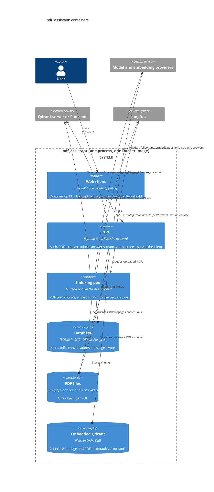

# Containers

What runs and where data lives, as in the Docker image: one process serves the API, the indexing
pool and the built client. In development the web client is served by Vite instead and forwards
`/api` to the API. The database and the PDF files sit inside the boundary in their default form
(SQLite and a folder in `DATA_DIR`); with Postgres or Supabase Storage they move outside it. Source:
[architecture overview](../architecture/overview.md), [backend](../reference/services/backend.md),
[client](../reference/services/client.md) and [codebase](../reference/codebase.md).

