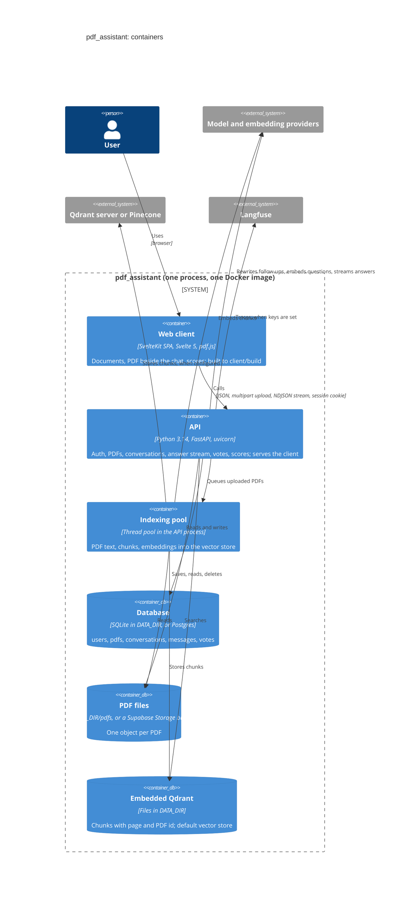

# Containers

What runs and where data lives. One process serves the API, the indexing pool and the built client.
Source: [architecture overview](../architecture/overview.md) and
[codebase](../reference/codebase.md).

