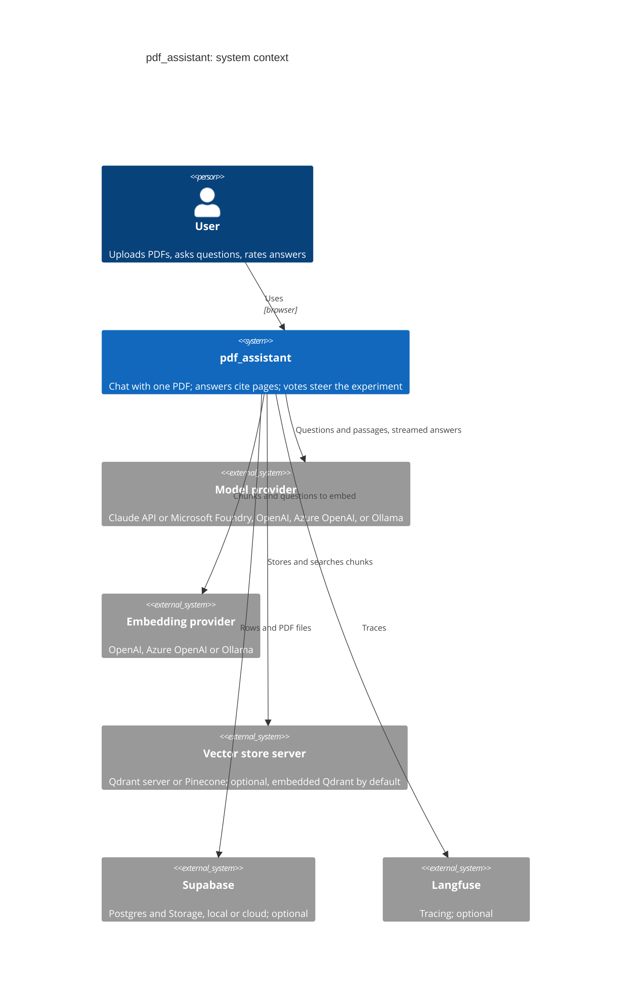

# System context

pdf_assistant and the outside systems it can use. Every outside system except the model provider is
optional: by default the database, files and vectors stay inside the one process. Source:
[architecture overview](../architecture/overview.md#shape).

